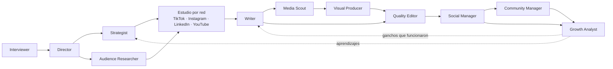

# 🚀 ORE Studio — Tu agencia de marketing completa, en un solo comando

> **De una idea a una campaña lista para publicar en minutos.**
> Un equipo virtual de **16 agentes con personalidad propia** que te entrevista, estudia cada red social, escribe, diseña, revisa y optimiza tu contenido para **TikTok, Instagram, LinkedIn, YouTube** (y Facebook si lo quieres).

Sin freelancers. Sin reuniones eternas. Sin empezar desde cero. Tú cuentas qué quieres lograr; tu agencia hace el resto.

---

> **Autohospedable:** esta skill no trae un owner, clientes ni credenciales fijas. Cada persona que la instala configura su propia organización, bot, base de datos, Drive y APIs. Consulta [la guía de conexión](docs/operations/connect-integrations.md) y [el estado verificable de capacidades](docs/operations/capability-status.md).

## ✨ ¿Por qué ORE Studio?

| Antes | Con ORE Studio |
|-------|----------------|
| Semanas coordinando estrategia, copy y diseño | Una campaña completa desde una conversación corta |
| Formularios y reuniones con preguntas interminables | Entrevista de **máximo 5 preguntas**, con respuesta sugerida |
| El mismo guion pegado en todas las redes | **Un estudio por red social** antes de cada guion |
| Equipos que no se hablan entre sí | Agentes **conectados**: cada uno sabe quién le entrega y a quién entrega |
| Publicar "a ver qué pasa" | Decisiones guiadas por audiencia y métricas, con ciclo de mejora |

**Lo que recibes en cada proyecto:**
- 📋 Brief validado, con los supuestos marcados para que los corrijas
- 🔬 Un estudio por red (comportamiento, formato, ganchos, reglas, métricas)
- 🎬 Guiones por red + composiciones de video
- ✅ Revisión de calidad contra las reglas de cada plataforma
- 📅 Calendario, guía de comunidad y plan de experimentos
- 🧾 Checkpoint con quién entregó qué a quién

---

## 🧠 El cerebro principal: Sabrina Ramonov

Detrás de los agentes hay un **criterio compartido** inspirado en el enfoque público de **[Sabrina Ramonov](https://www.sabrina.dev)**: contenido con IA práctico, automatizado y orientado a resultados. Ese núcleo guía a todo el equipo, y cada agente suma su propia especialidad y personalidad encima.

> ORE Studio se inspira en su enfoque público documentado. No es un producto oficial de Sabrina Ramonov ni se le atribuyen decisiones privadas.

---

## 🤖 Conoce a tu equipo

Además del equipo creativo, la operación incorpora Dirección Operativa, Ventas, Onboarding, Operaciones de Proyecto y Operaciones de Caja. Sus fichas documentan personalidad, referentes, límites, desacuerdos y handoffs; ninguna suplanta la voz de la marca ni autoriza gastos por sí sola.

Cada agente tiene **especialidad, personalidad y referentes reales** (su fuente de verdad es [`agents/personas.py`](ore-studio/agents/personas.py)).

### Entrevista y dirección
| Agente | Qué hace por ti | Personalidad | Inspirado en |
|--------|-----------------|--------------|--------------|
| 🎙️ **Interviewer** | Entiende qué buscas, tus objetivos y tu comprador **sin interrogatorios**: máx. 5 preguntas | Curioso y directo; una pregunta a la vez con opción recomendada | **Rob Fitzpatrick** (The Mom Test), **Michael Bungay Stanier**, **Simon Sinek**, **Bob Moesta** |
| 🎬 **Director** | Lidera, define la visión y los criterios de "terminado" | Sereno y decidido | **Steve Jobs**, **Christopher Nolan**, **Lee Clow** |
| 🧭 **Strategist** | Idea central, pilares y KPI | Claro y provocador | **David Ogilvy**, **Seth Godin**, **Philip Kotler** |
| 🔍 **Audience Researcher** | Dolores, lenguaje real y mentalidad por red | Observador y empírico | **Rand Fishkin**, **Byron Sharp**, **Clayton Christensen** |

### Especialistas por red social (cada uno hace su estudio antes de cualquier guion)
| Agente | Qué estudia y entrega | Personalidad | Inspirado en |
|--------|-----------------------|--------------|--------------|
| 🎵 **TikTok Strategist** | Ganchos, retención y tendencias de video corto | Rápido, directo, sin relleno | **Brendan Kane**, **Alex Hormozi**, **Khaby Lame**, **MrBeast** |
| 📸 **Instagram Strategist** | Reels, carruseles y Stories para envíos y guardados | Cuidado y visual | **Adam Mosseri**, **Sue B. Zimmerman**, **Jenna Kutcher** |
| 💼 **LinkedIn Strategist** | Posts, carruseles y video con autoridad | Profesional pero humano | **Justin Welsh**, **Lara Acosta**, **Jasmin Alić** |
| ▶️ **YouTube Strategist** | Shorts y video largo: título, miniatura, retención | Analítico y narrativo | **Paddy Galloway**, **MrBeast**, **Ali Abdaal**, **Sean Cannell** |
| 👥 **Facebook Strategist** *(opcional)* | Reels, comunidades y conversación | Cercano y conversador | **Mari Smith** |

### Producción y calidad
| Agente | Qué hace por ti | Personalidad | Inspirado en |
|--------|-----------------|--------------|--------------|
| ✍️ **Writer** | Un guion por red, **solo después de su estudio** | Conciso, con ritmo | **Eugene Schwartz**, **Joanna Wiebe**, **Ann Handley** |
| 🧲 **Media Scout** | Busca imágenes, videos y memes del tema, con licencia registrada | Metódico, cuidadoso con derechos | Curadores de moodboards y equipos de contenido viral |
| 🎨 **Visual Producer** | Motion graphics y composiciones de video desde código | Preciso y técnico | **[Remotion](https://www.remotion.dev)** |
| 🛡️ **Quality Editor** | Revisa cada pieza contra las reglas de su red | Exigente pero justo | **William Zinsser**, **Maxwell Perkins**, **Marty Neumeier** |

### Publicación, comunidad y crecimiento
| Agente | Qué hace por ti | Personalidad | Inspirado en |
|--------|-----------------|--------------|--------------|
| 📅 **Social Manager** | Calendario y adaptación por plataforma | Organizado y práctico | **Gary Vaynerchuk**, **Mari Smith**, **Ann Handley** |
| 💬 **Community Manager** | Responde y construye comunidad fiel | Cálido y atento | **Kevin Kelly**, **Jono Bacon**, **Pat Flynn** |
| 📈 **Growth Analyst** | Métricas, experimentos A/B y aprendizajes que vuelven a la estrategia | Escéptico y basado en datos | **Neil Patel**, **Sean Ellis**, **Brian Balfour**, **Avinash Kaushik** |

> Son referentes de la industria que inspiran el enfoque de cada rol; no están afiliados ni respaldan ORE Studio.

---

## 🔗 Todo conectado



El Writer **no escribe** para una red si su estudio no existe. El Growth Analyst devuelve lo aprendido al Strategist y al Writer.

---

## ⚡ Pruébalo en 2 minutos

```bash
# 1. Clona el proyecto
git clone https://github.com/anibalelore/orestudio.git
cd "ORE Studio"

# 2. Corre la agencia (te entrevista con máximo 5 preguntas)
python ore-studio/scripts/run_agency.py --project mi-campana

# …o sin entrevista, directo:
python ore-studio/scripts/run_agency.py --project cafe --yes \
  --offer "Café de especialidad por suscripción" \
  --buyer "oficinistas" --channel tiktok,linkedin
```

Los resultados quedan en `output/<proyecto>/`.

Cada ejecución guarda `client-profile.json` con el contexto reutilizable de la marca. Para iniciar otra campaña sin repetir las preguntas sobre el negocio:

```bash
python ore-studio/scripts/run_agency.py --project nueva-campana --yes \
  --profile output/mi-proyecto/client-profile.json --channel tiktok,linkedin
```

> Las reglas por red social son heurísticas de trabajo: contrástalas con datos actuales de cada plataforma y con tus propias métricas. El pipeline genera la estructura, los estudios y las revisiones; el texto final lo pule el agente anfitrión (LLM).

---

## 🗂️ Estructura del proyecto

```
ORE Studio/
├─ ore-studio/
│  ├─ SKILL.md                    # Definición / router de la skill
│  ├─ agents/
│  │   ├─ personas.py             # Personalidades, inspiraciones y conexiones
│  │   ├─ interviewer.py          # Entrevista corta (máx. 5 preguntas)
│  │   ├─ platform_playbooks.py   # Estudio por red + generador de guiones
│  │   ├─ pipeline.py             # Orquestador que conecta a todos
│  │   ├─ image_reference_agent.py / video_meme_agent.py / _media.py   # Media Scout
│  │   └─ tiktok_agent.py, instagram_agent.py, social_manager.py, ...
│  ├─ scripts/
│  │   ├─ run_agency.py           # Ejecuta la agencia completa
│  │   ├─ search_corpus.py
│  │   └─ package_skill.py
│  └─ requirements.txt
├─ docs/                          # Documentación, prompts, especificaciones
└─ README.md                      # (este archivo)
```

---

## 🙌 Súmate

¿Te gustó? Dale ⭐ al repo, haz un fork, crea tus propios agentes y cuéntanos qué campañas lanzaste.

## 📄 Licencia

Distribuido bajo la **[Licencia Apache 2.0](LICENSE)** — úsalo, modifícalo y construye tu propio negocio con él.
