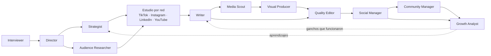

# 🚀 OREBAL Studio — Tu agencia de marketing completa, en un solo comando

**Versión 2.0.0**

> **De una idea a una campaña lista para publicar en minutos.**
> Un equipo virtual de **21 agentes con personalidad propia** que te entrevista, estudia cada red social, escribe, diseña, revisa, opera y optimiza tu contenido para **TikTok, Instagram, LinkedIn, YouTube** (y Facebook si lo quieres).

Sin freelancers. Sin reuniones eternas. Sin empezar desde cero. Tú cuentas qué quieres lograr; tu agencia hace el resto.

---

> **Autohospedable:** esta skill no trae un owner, clientes ni credenciales fijas. Cada persona que la instala configura su propia organización, bot, base de datos, Drive y APIs. Consulta [la guía de conexión](docs/operations/connect-integrations.md) y [el estado verificable de capacidades](docs/operations/capability-status.md).

## Novedades de OREBAL Studio 2.0

- **Entrevista con máximo 5 preguntas:** el Interviewer recupera contexto previo, propone respuestas y evita interrogatorios infinitos.
- **Perfil reutilizable por cliente:** la marca, oferta, audiencia, voz y restricciones se versionan para no empezar desde cero en cada campaña.
- **Estudio obligatorio por red social:** TikTok, Instagram, LinkedIn, YouTube y Facebook tienen estratega, comportamiento, formatos, ganchos, CTA y métricas propios antes de escribir un guion.
- **21 agentes con personalidad y referentes:** incorpora Dirección Operativa, Ventas, Onboarding, Operaciones de Proyecto y Operaciones de Caja al equipo creativo existente.
- **Handoffs conectados:** cada agente declara de quién recibe, a quién entrega y qué significa “terminado”. El análisis de resultados vuelve a estrategia y escritura.
- **Contexto por organización, cliente y proyecto:** evita mezclar marcas, archivos, conversaciones o campañas.
- **Telegram privado y seguro:** valida secreto del webhook, ID numérico del owner, chat privado, callbacks opacos y `update_id` repetidos.
- **Operación durable:** trabajos en cola con reserva, reintentos, recuperación de ejecuciones abandonadas, backoff y estado de atención manual.
- **Aprobaciones seguras:** tokens de un solo uso, caducidad, validación de owner/proyecto/versión y rechazo de aprobaciones ambiguas.
- **Pausa y control de efectos externos:** una pausa global o por proyecto se vuelve a comprobar antes de publicar, cobrar, gastar o enviar.
- **Google Drive idempotente:** estructura estándar por cliente/proyecto, IDs persistidos, versiones `v001`, `v002` y shortcuts sin duplicar archivos.
- **Supabase multi-tenant:** esquema para owners, clientes, perfiles, proyectos, tareas, artefactos, aprobaciones, auditoría, notificaciones y costos.
- **Panel Next.js compartido:** vistas de clientes, proyectos, estado y resúmenes sobre la misma fuente de verdad que Telegram.
- **Configuración por owner:** cada instalación usa sus propias credenciales, organización, bot, base de datos, Drive, proveedores y límites.
- **Estado honesto de integraciones:** la documentación separa lo probado localmente, lo implementado sin conexión real y lo pendiente por credenciales o wiring.

## Instalación rápida

### Solo la skill y el pipeline local

```bash
git clone https://github.com/anibalelore/orestudio.git
cd orestudio
python orebal-studio/scripts/run_agency.py --project demo
```

Para una ejecución sin entrevista:

```bash
python orebal-studio/scripts/run_agency.py --project demo --yes \
  --offer "Tu oferta" --buyer "Tu comprador" \
  --channel tiktok,instagram,linkedin,youtube
```

### Control plane local

```bash
cd apps/control-plane
npm ci
cp .env.example .env.local
npm test
npm run dev
```

En PowerShell usa `Copy-Item .env.example .env.local`. Después completa las variables de `.env.local`. Para Telegram + Supabase + Drive + Vercel, sigue la sección [Instalación completa del control plane](#instalación-completa-del-control-plane).

> La skill y el pipeline Python funcionan localmente. El control plane compila y sus contratos están probados, pero el webhook y el worker desplegados todavía requieren inicializar las dependencias reales antes de usarlos en producción.

## ✨ ¿Por qué OREBAL Studio?

| Antes | Con OREBAL Studio |
|-------|----------------|
| Semanas coordinando estrategia, copy y diseño | Una campaña completa desde una conversación corta |
| Formularios y reuniones con preguntas interminables | Entrevista de **máximo 5 preguntas**, con respuesta sugerida |
| El mismo guion pegado en todas las redes | **Un estudio por red social** antes de cada guion |
| Equipos que no se hablan entre sí | Agentes **conectados**: cada uno sabe quién le entrega y a quién entrega |
| Publicar "a ver qué pasa" | Decisiones guiadas por audiencia y métricas, con ciclo de mejora |

**Lo que recibes en cada proyecto:**
- 📋 Brief validado, con los supuestos marcados para que los corrijas
- 🔬 Un estudio por red (comportamiento, formato, ganchos, reglas, métricas)
- 🎬 Guiones por red + composiciones de video
- ✅ Revisión de calidad contra las reglas de cada plataforma
- 📅 Calendario, guía de comunidad y plan de experimentos
- 🧾 Checkpoint con quién entregó qué a quién

---

## 🧠 El cerebro principal: Sabrina Ramonov

Detrás de los agentes hay un **criterio compartido** inspirado en el enfoque público de **[Sabrina Ramonov](https://www.sabrina.dev)**: contenido con IA práctico, automatizado y orientado a resultados. Ese núcleo guía a todo el equipo, y cada agente suma su propia especialidad y personalidad encima.

> OREBAL Studio se inspira en su enfoque público documentado. No es un producto oficial de Sabrina Ramonov ni se le atribuyen decisiones privadas.

---

## 🤖 Conoce a tu equipo

Además del equipo creativo, la operación incorpora Dirección Operativa, Ventas, Onboarding, Operaciones de Proyecto y Operaciones de Caja. Sus fichas documentan personalidad, referentes, límites, desacuerdos y handoffs; ninguna suplanta la voz de la marca ni autoriza gastos por sí sola.

Cada agente tiene **especialidad, personalidad y referentes reales** (su fuente de verdad es [`agents/personas.py`](orebal-studio/agents/personas.py)).

### Entrevista y dirección
| Agente | Qué hace por ti | Personalidad | Inspirado en |
|--------|-----------------|--------------|--------------|
| 🎙️ **Interviewer** | Entiende qué buscas, tus objetivos y tu comprador **sin interrogatorios**: máx. 5 preguntas | Curioso y directo; una pregunta a la vez con opción recomendada | **Rob Fitzpatrick** (The Mom Test), **Michael Bungay Stanier**, **Simon Sinek**, **Bob Moesta** |
| 🎬 **Director** | Lidera, define la visión y los criterios de "terminado" | Sereno y decidido | **Steve Jobs**, **Christopher Nolan**, **Lee Clow** |
| 🧭 **Strategist** | Idea central, pilares y KPI | Claro y provocador | **David Ogilvy**, **Seth Godin**, **Philip Kotler** |
| 🔍 **Audience Researcher** | Dolores, lenguaje real y mentalidad por red | Observador y empírico | **Rand Fishkin**, **Byron Sharp**, **Clayton Christensen** |

### Especialistas por red social (cada uno hace su estudio antes de cualquier guion)
| Agente | Qué estudia y entrega | Personalidad | Inspirado en |
|--------|-----------------------|--------------|--------------|
| 🎵 **TikTok Strategist** | Ganchos, retención y tendencias de video corto | Rápido, directo, sin relleno | **Brendan Kane**, **Alex Hormozi**, **Khaby Lame**, **MrBeast** |
| 📸 **Instagram Strategist** | Reels, carruseles y Stories para envíos y guardados | Cuidado y visual | **Adam Mosseri**, **Sue B. Zimmerman**, **Jenna Kutcher** |
| 💼 **LinkedIn Strategist** | Posts, carruseles y video con autoridad | Profesional pero humano | **Justin Welsh**, **Lara Acosta**, **Jasmin Alić** |
| ▶️ **YouTube Strategist** | Shorts y video largo: título, miniatura, retención | Analítico y narrativo | **Paddy Galloway**, **MrBeast**, **Ali Abdaal**, **Sean Cannell** |
| 👥 **Facebook Strategist** *(opcional)* | Reels, comunidades y conversación | Cercano y conversador | **Mari Smith** |

### Producción y calidad
| Agente | Qué hace por ti | Personalidad | Inspirado en |
|--------|-----------------|--------------|--------------|
| ✍️ **Writer** | Un guion por red, **solo después de su estudio** | Conciso, con ritmo | **Eugene Schwartz**, **Joanna Wiebe**, **Ann Handley** |
| 🧲 **Media Scout** | Busca imágenes, videos y memes del tema, con licencia registrada | Metódico, cuidadoso con derechos | Curadores de moodboards y equipos de contenido viral |
| 🎨 **Visual Producer** | Motion graphics y composiciones de video desde código | Preciso y técnico | **[Remotion](https://www.remotion.dev)** |
| 🛡️ **Quality Editor** | Revisa cada pieza contra las reglas de su red | Exigente pero justo | **William Zinsser**, **Maxwell Perkins**, **Marty Neumeier** |

### Publicación, comunidad y crecimiento
| Agente | Qué hace por ti | Personalidad | Inspirado en |
|--------|-----------------|--------------|--------------|
| 📅 **Social Manager** | Calendario y adaptación por plataforma | Organizado y práctico | **Gary Vaynerchuk**, **Mari Smith**, **Ann Handley** |
| 💬 **Community Manager** | Responde y construye comunidad fiel | Cálido y atento | **Kevin Kelly**, **Jono Bacon**, **Pat Flynn** |
| 📈 **Growth Analyst** | Métricas, experimentos A/B y aprendizajes que vuelven a la estrategia | Escéptico y basado en datos | **Neil Patel**, **Sean Ellis**, **Brian Balfour**, **Avinash Kaushik** |

> Son referentes de la industria que inspiran el enfoque de cada rol; no están afiliados ni respaldan OREBAL Studio.

---

## 🔗 Todo conectado



El Writer **no escribe** para una red si su estudio no existe. El Growth Analyst devuelve lo aprendido al Strategist y al Writer.

---

## ⚡ Pruébalo en 2 minutos

```bash
# 1. Clona el proyecto
git clone https://github.com/anibalelore/orestudio.git
cd orestudio

# 2. Corre la agencia (te entrevista con máximo 5 preguntas)
python orebal-studio/scripts/run_agency.py --project mi-campana

# …o sin entrevista, directo:
python orebal-studio/scripts/run_agency.py --project cafe --yes \
  --offer "Café de especialidad por suscripción" \
  --buyer "oficinistas" --channel tiktok,linkedin
```

Los resultados quedan en `output/<proyecto>/`.

Cada ejecución guarda `client-profile.json` con el contexto reutilizable de la marca. Para iniciar otra campaña sin repetir las preguntas sobre el negocio:

```bash
python orebal-studio/scripts/run_agency.py --project nueva-campana --yes \
  --profile output/mi-proyecto/client-profile.json --channel tiktok,linkedin
```

> Las reglas por red social son heurísticas de trabajo: contrástalas con datos actuales de cada plataforma y con tus propias métricas. El pipeline genera la estructura, los estudios y las revisiones; el texto final lo pule el agente anfitrión (LLM).

---

## Instalación completa del control plane

Cada instalación de OREBAL Studio pertenece a un owner distinto. El repositorio no incluye cuentas, clientes, IDs ni credenciales de Aníbal, eQatu o cualquier otro piloto.

### Arquitectura

```text
Owner → bot privado de Telegram → webhook Next.js en Vercel
                                      ↓
                         Supabase: estado, contexto y cola
                                      ↓
                         Worker → agentes OREBAL Studio
                                      ↓
                         Google Drive: entregables versionados
```

El panel web y Telegram leen el mismo estado. El webhook registra encargos y el worker los ejecuta de forma durable; Google Drive conserva los archivos y Supabase conserva IDs, permisos, contexto, versiones y auditoría.

### Requisitos

- Node.js compatible con Next.js 16 y Python 3.11 o posterior.
- Una cuenta de Telegram y un bot creado con **BotFather**.
- Un proyecto de Supabase.
- Una carpeta de Google Drive y credenciales OAuth 2.0 o una cuenta de servicio.
- Una cuenta de Vercel, o un servidor equivalente capaz de alojar Next.js y ejecutar un scheduler.

### 1. Instalar y probar localmente

```bash
git clone https://github.com/anibalelore/orestudio.git
cd orestudio/apps/control-plane
npm ci
cp .env.example .env.local
npm test
npm run typecheck
npm run build
```

En PowerShell, reemplaza el comando de copia por:

```powershell
Copy-Item .env.example .env.local
```

Para ejecutar el pipeline de agentes sin el control plane:

```bash
cd ../..
python orebal-studio/scripts/run_agency.py --project demo
```

### 2. Variables de entorno

Configura estas variables en `.env.local` para desarrollo y después en el gestor de secretos de Vercel o de tu servidor:

```dotenv
NODE_ENV=production
OREBAL_ADAPTER_MODE=fake
OREBAL_ORGANIZATION_ID=identificador_unico_de_tu_organizacion

TELEGRAM_OWNER_ID=id_numerico_del_owner
TELEGRAM_PRIVATE_CHAT_ID=id_numerico_del_chat_privado
TELEGRAM_WEBHOOK_SECRET=secreto_aleatorio_de_16_o_mas_caracteres

INTERNAL_WORKER_SECRET=otro_secreto_aleatorio

SUPABASE_URL=https://tu-proyecto.supabase.co
SUPABASE_SERVICE_ROLE_KEY=service_role_solo_del_servidor

DRIVE_ROOT_FOLDER_ID=id_de_la_carpeta_raiz

WORKER_MAX_JOBS=5
WORKER_DEADLINE_MS=20000
TELEGRAM_MAX_FILE_BYTES=20971520
```

No subas `.env.local`. `SUPABASE_SERVICE_ROLE_KEY` debe permanecer exclusivamente en el servidor. Usa secretos diferentes para Telegram y el worker.

### 3. Configurar Supabase

1. Crea un proyecto para la instalación.
2. Instala la CLI de Supabase e inicia sesión.
3. Desde la raíz del repositorio, vincula el proyecto y aplica las migraciones:

```bash
supabase login
supabase link --project-ref TU_PROJECT_REF
supabase db push
```

La migración base está en [`supabase/migrations/202610170001_control_plane.sql`](supabase/migrations/202610170001_control_plane.sql). Crea organizaciones, owners, clientes, perfiles, proyectos, tareas, aprobaciones, auditoría y políticas de aislamiento. Prueba primero en un proyecto no productivo y conserva todos los cambios posteriores como migraciones versionadas.

> Estado actual: el esquema y los adaptadores contractuales existen, pero los RPC de la cola y el mapeo completo del adaptador real todavía no están certificados contra un proyecto Supabase real. No actives producción hasta completar esa conexión.

### 4. Configurar Telegram

1. Crea el bot con `@BotFather` y guarda el token fuera del repositorio.
2. Obtén el ID numérico del owner y el ID del chat privado; colócalos en `TELEGRAM_OWNER_ID` y `TELEGRAM_PRIVATE_CHAT_ID`.
3. Despliega primero el control plane para obtener una URL HTTPS.
4. Registra el webhook reemplazando los valores siguientes:

```bash
curl -X POST "https://api.telegram.org/botTU_BOT_TOKEN/setWebhook" \
  -H "Content-Type: application/json" \
  -d '{
    "url": "https://TU_DOMINIO/api/telegram/webhook",
    "secret_token": "TU_TELEGRAM_WEBHOOK_SECRET",
    "allowed_updates": ["message", "callback_query"]
  }'
```

Telegram enviará el secreto en `X-Telegram-Bot-Api-Secret-Token`. OREBAL Studio valida ese encabezado, el ID numérico del owner y que el mensaje venga del chat privado configurado.

> Estado actual: el handler está probado con dobles, pero la ruta desplegada devuelve `503` hasta inicializar las dependencias reales. No registres el webhook productivo antes de completar ese wiring.

### 5. Configurar Google Drive

1. Crea una carpeta raíz dedicada a OREBAL Studio.
2. Habilita Google Drive API en tu proyecto de Google Cloud.
3. Configura OAuth 2.0 o una cuenta de servicio y comparte la carpeta con esa identidad.
4. Copia el ID de la carpeta a `DRIVE_ROOT_FOLDER_ID`.
5. Verifica que la identidad pueda crear carpetas, archivos y shortcuts.

Si usas una cuenta de servicio, recuerda que no tiene cuota propia para ser dueña de archivos; usa una carpeta compartida apropiada o un Shared Drive compatible. El adaptador crea estructuras idempotentes por cliente y proyecto para evitar carpetas duplicadas.

### 6. Desplegar en Vercel

1. Importa `anibalelore/orestudio` desde Vercel.
2. Define **Root Directory** como `apps/control-plane`.
3. Conserva Next.js como framework detectado.
4. Carga todas las variables anteriores en **Project Settings → Environment Variables**.
5. Despliega y comprueba el panel antes de registrar Telegram.

El archivo [`apps/control-plane/vercel.json`](apps/control-plane/vercel.json) configura un cron diario hacia `/api/internal/worker`. La frecuencia real y los límites de ejecución dependen del plan de Vercel. El endpoint del worker debe validar `INTERNAL_WORKER_SECRET` antes de procesar trabajos.

> Estado actual: el build de Vercel está verificado localmente, pero el webhook y el worker exportados aún esperan inicialización real y responden `503`. El despliegue sirve para inspeccionar el panel y continuar la integración, no para afirmar operación productiva completa.

### 7. Verificación antes de producción

```bash
cd apps/control-plane
npm test
npm run typecheck
npm run build
cd ../..
python -m unittest discover -s tests -v
```

Después verifica manualmente:

- Un usuario o chat de Telegram diferente debe ser rechazado.
- Repetir el mismo `update_id` no debe crear otra tarea.
- Un cliente no puede leer proyectos o artefactos de otro.
- Repetir la creación de estructura Drive debe reutilizar IDs.
- Pausar globalmente o por proyecto debe impedir efectos externos.
- Ninguna publicación, cobro o gasto ocurre sin autorización explícita.

Consulta la [guía operativa ampliada](docs/operations/connect-integrations.md) y la [matriz de capacidades y bloqueos](docs/operations/capability-status.md) antes de activar credenciales reales.

### Referencias oficiales

- [Telegram Bot API — webhooks y `secret_token`](https://core.telegram.org/bots/api)
- [Supabase — migraciones y despliegue](https://supabase.com/docs/guides/deployment/database-migrations)
- [Google Drive API](https://developers.google.com/workspace/drive/api/guides/about-sdk)
- [Google Shared Drives](https://developers.google.com/workspace/drive/api/guides/about-shareddrives)
- [Vercel — configuración del proyecto](https://vercel.com/docs/project-configuration/project-settings)
- [Vercel — cron jobs](https://vercel.com/docs/cron-jobs/manage-cron-jobs)

---

## 🗂️ Estructura del proyecto

```
OREBAL Studio/
├─ orebal-studio/
│  ├─ SKILL.md                    # Definición / router de la skill
│  ├─ agents/
│  │   ├─ personas.py             # Personalidades, inspiraciones y conexiones
│  │   ├─ interviewer.py          # Entrevista corta (máx. 5 preguntas)
│  │   ├─ platform_playbooks.py   # Estudio por red + generador de guiones
│  │   ├─ pipeline.py             # Orquestador que conecta a todos
│  │   ├─ image_reference_agent.py / video_meme_agent.py / _media.py   # Media Scout
│  │   └─ tiktok_agent.py, instagram_agent.py, social_manager.py, ...
│  ├─ scripts/
│  │   ├─ run_agency.py           # Ejecuta la agencia completa
│  │   ├─ search_corpus.py
│  │   └─ package_skill.py
│  └─ requirements.txt
├─ docs/                          # Documentación, prompts, especificaciones
└─ README.md                      # (este archivo)
```

---

## 🙌 Súmate

¿Te gustó? Dale ⭐ al repo, haz un fork, crea tus propios agentes y cuéntanos qué campañas lanzaste.

## 📄 Licencia

Distribuido bajo la **[Licencia Apache 2.0](LICENSE)** — úsalo, modifícalo y construye tu propio negocio con él.
