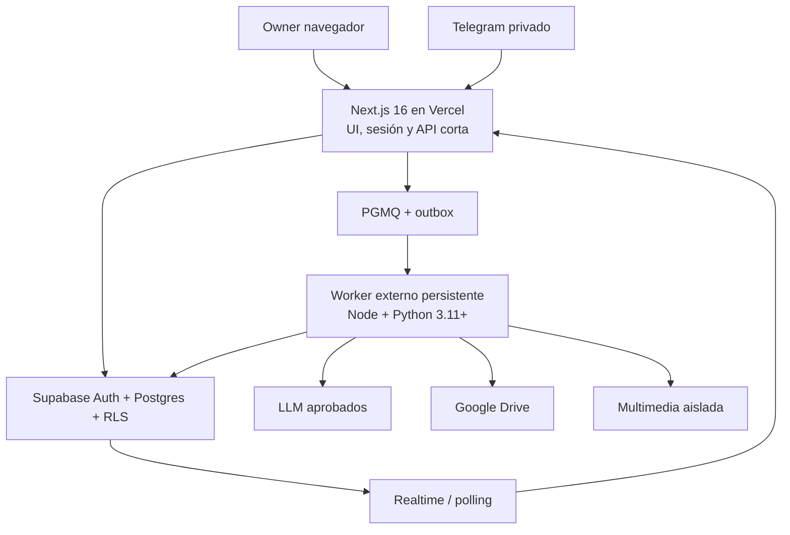

# OREBAL Studio 2.0 — Fase 1: plataforma operativa

**Estado:** diseño aprobado el 18 de octubre de 2026. No equivale a despliegue ni certificación de producción.

## Objetivo

Convertir `apps/control-plane` en una aplicación segura para una organización operada por su Owner, con múltiples clientes y proyectos y una base preparada para SaaS multi-organización. El Owner podrá reclamar la instalación, autenticarse, conectar servicios, crear clientes/proyectos, encomendar trabajo, observar tareas reales, recibir y aprobar entregables y auditar la operación.

Los pilotos Aníbal el Ore y eQatu se crean manualmente desde la UI; nunca se distribuyen como datos iniciales. Contextos, archivos, conversaciones y material privado permanecen aislados por organización, cliente y proyecto.

## Límites

- Fase 2 (oficina virtual, escenas 3D, personajes o animación) queda fuera.
- Sin SaaS público, suscripciones o cobros automáticos.
- No declarar conectada una integración por la mera existencia de un adaptador.
- Publicaciones, pagos, gastos y mensajes externos se niegan por defecto y requieren autorización exacta.
- No reutilizar material creativo rechazado por el Owner.
- No reemplazar los 21 agentes ni renombrar nuevamente OREBAL Studio.

## Base que se conserva

- `orebal-studio/`: pipeline Python, 21 agentes, entrevista consentida y estudios por red.
- `apps/control-plane/`: Next.js 16, contratos de repositorio/cola, tareas, pausas, aprobaciones, webhook y worker desacoplados.
- `supabase/migrations/202610170001_control_plane.sql`: modelo inicial, auditoría, costos y PGMQ.
- Pruebas TypeScript, Python, aceptación y documentación operativa actuales.

## Bloqueos actuales vinculantes

1. Webhook y worker exportados responden `503`; sus factorías solo están probadas con dobles.
2. El adaptador Supabase requiere DTO camelCase/snake_case, consultas y transacciones reales.
3. Faltan los RPC `ore_*_job` invocados por `SupabaseQueue`.
4. El subprocess Python debe ejecutarse en un worker persistente externo, no como trabajo largo de Vercel.
5. No existen login, bootstrap, onboarding ni UI operativa conectada a datos reales.
6. El aislamiento debe derivarse de sesión y membresía, nunca de un `organization_id` confiado al navegador.

## Arquitectura

Vercel aloja UI, sesiones y APIs breves. Supabase mantiene identidad, estado canónico, RLS, cola y eventos. El worker externo ejecuta Python, IA y multimedia. Telegram y UI producen las mismas tareas. El backend emite hechos; una futura oficina solo los representa.

## Bootstrap y primer acceso

`/setup` existe únicamente mientras la instalación no está reclamada:

1. Muestra prerrequisitos sin valores secretos.
2. Consume un `OREBAL_BOOTSTRAP_TOKEN` efímero mediante transacción atómica de un solo uso.
3. Crea/verifica cuenta Supabase Auth y habilita MFA TOTP para Owner.
4. Crea organización: nombre, zona horaria, idioma y moneda.
5. Conecta y prueba al menos un proveedor IA con presupuesto.
6. Conecta Drive y verifica crear/releer/conciliar un archivo de prueba.
7. Vincula Telegram opcionalmente mediante challenge de un solo uso e identidad numérica.
8. Presenta los 21 agentes, módulos, proveedor y límites.
9. Permite crear primer cliente/proyecto o ir al dashboard.
10. Ejecuta chequeo de BD, worker, cola, IA, Drive, webhook y notificaciones.

Tras reclamar, `/setup` queda cerrado. Todas las rutas administrativas exigen sesión y rol.

## UI de Fase 1

Diseño nuevo de productividad precisa: navegación lateral, tablas legibles, paneles de detalle, responsive, teclado, tema claro/oscuro y estados loading/empty/error. Sin gráficos decorativos ni actividad ficticia.

- `/login`, `/account/security`: sesión, recuperación, MFA y dispositivos.
- `/dashboard`: cola, ejecución, aprobaciones, errores, costos y actividad reales.
- `/inbox`, `/chat`: decisiones, incidentes, conversación contextual y adjuntos.
- `/clients`, `/clients/[clientId]`: CRUD, marca, canales, Drive y perfiles.
- `/projects`, `/projects/[projectId]`: briefs, campañas, tareas y entregables.
- `/tasks/[taskId]`: timeline, agentes, IO, reintentos y errores seguros.
- `/agents`, `/agents/[agentId]`: registro real de 21 personas, estado, modelo, permisos y costos.
- `/calendar`, `/files`, `/integrations`, `/analytics`, `/settings`.

Un agente solo muestra `working` si existe trabajo real. Otros estados: `available`, `waiting_approval`, `blocked`, `offline`.

## Datos incrementales

Una migración nueva amplía, no reemplaza, tablas e IDs existentes:

- `organization_members`, `installation_claims/settings`, `user_invitations`.
- Owner web válido sin Telegram obligatorio; Telegram como identidad vinculable.
- `provider_connections` con `secret_ref`, nunca tokens en JSON/logs.
- `agent_configurations`, `agent_runs`, `agent_events`, `conversation_messages`.
- RPC PGMQ idempotentes con claim transaccional, lease, retry, backoff, dead-letter y recuperación.
- DTO validados camelCase ↔ snake_case; referencias cross-tenant impedidas atómicamente.
- `outbox_events` para eventos transaccionales antes de Realtime.

## Roles y seguridad

Roles: Owner, Admin, Manager, Editor y Viewer. Los privilegios se comprueban en API, BD y worker. RLS cubre toda tabla expuesta; service-role solo servidor/worker. Acciones externas requieren versión, ámbito, destino, caducidad y uso único. Auditoría append-only, pausa global/proyecto, secretos rotables, anti-replay, rate limit, logs sin PII/tokens, backups/restauración y separación dev/staging/prod.

## Flujo extremo a extremo

El usuario autenticado crea cliente/proyecto; el backend deriva el tenant. Web/chat/Telegram crean `task` idempotente. Interviewer hace hasta 6 preguntas iniciales y extras consentidas. Tras aprobar el brief, Director/Operations Director coordinan y cada red se estudia antes de Writer. El worker reclama pasos, ejecuta Python, registra runs/eventos/costos y guarda versiones en Drive. Quality Editor y Owner controlan la salida. Publicación queda manual si OAuth/adaptador no está verificado. Growth Analyst registra únicamente métricas fechadas y con fuente.

## Eventos preparados para Fase 2

`agent_events` es append-only, ordenado por `sequence` y versionado. Eventos iniciales: `agent.assigned`, `agent.task_started`, `agent.task_progress`, `agent.artifact_created`, `agent.needs_approval`, `agent.task_completed`, `agent.task_failed`, `agent.blocked`, `agent.available`, `project.paused/resumed`, `approval.requested/resolved`. El payload nunca contiene secretos ni coordenadas visuales.

## Entregas

F1-A auditoría/entorno; F1-B Auth/bootstrap; F1-C Supabase real; F1-D worker; F1-E UI; F1-F integraciones; F1-G observabilidad; F1-H pilotos/release. Seguridad, persistencia y worker preceden cualquier declaración de dashboard operativo.

## Criterios de salida

- Setup reclamado una vez, MFA activo y rutas privadas cerradas.
- Roles y aislamiento cross-tenant/cross-client verificados.
- CRUD real de clientes/proyectos; 21 agentes con estado real.
- Tareas web y Telegram convergen en cola/dashboard sin doble efecto.
- Worker externo ejecuta pipeline y guarda versiones/evidencia/licencia en Drive.
- Webhook y worker dejan de responder `503` solo con runtime válido y autenticado.
- Owner aprueba, rechaza, pausa, reanuda y distingue costo estimado/observado.
- Pilotos permanecen aislados y la información reservada no llega a contenido público.
- Registro firmado de unitarias, contrato, staging, E2E y smoke de producción.

## Entrega técnica

Trabajar en `feat/orebal-phase1-control-plane`, con migraciones reversibles y commits pequeños. No mocks en producción, datos personales sembrados ni secretos en Git. Aplicar migraciones desde CI/proceso controlado. Vercel usa `apps/control-plane`; el worker vive fuera de Vercel con healthcheck y shutdown seguro.

